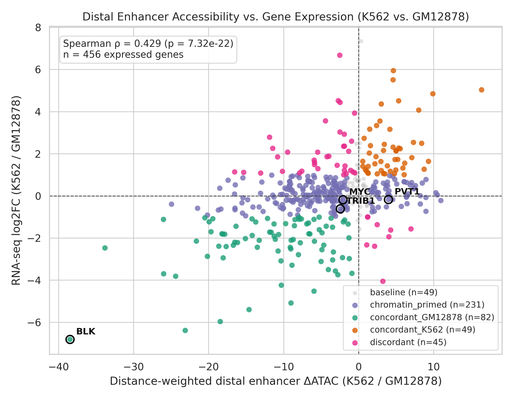
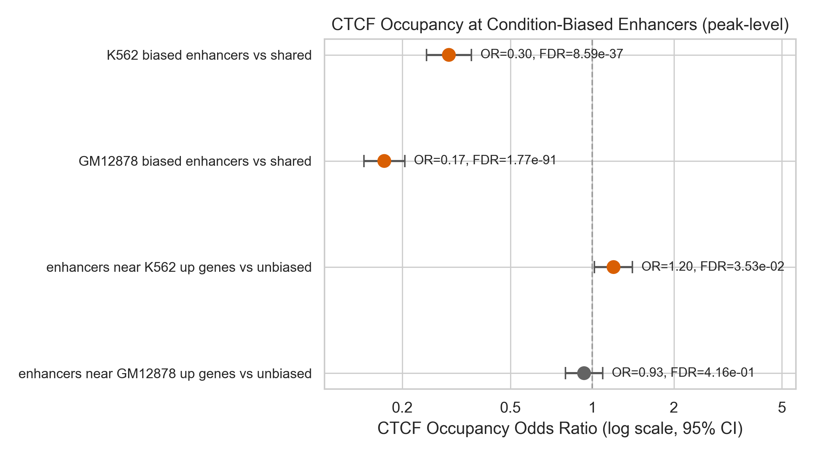
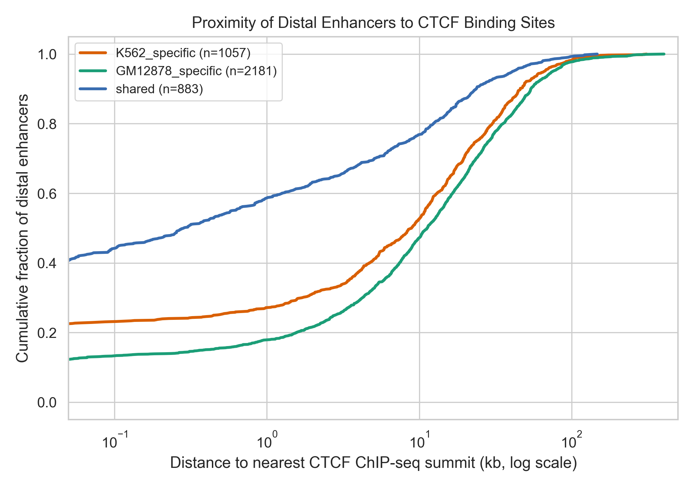
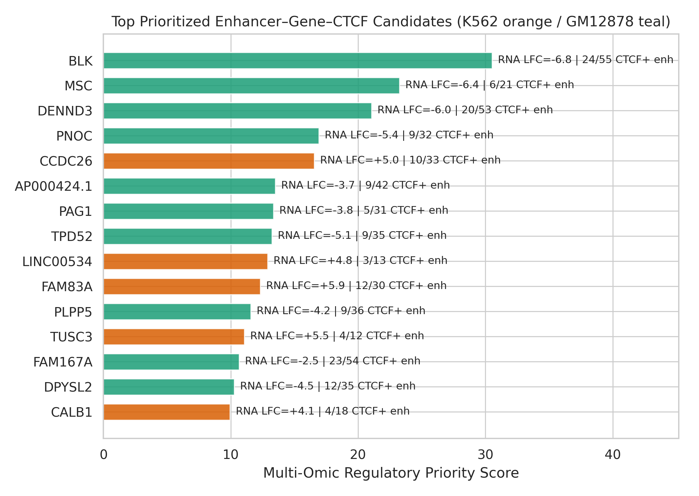

# enhancer-gene-atac-rna-ctcf

[](https://github.com/arjunbioinfo/enhancer-gene-atac-rna-ctcf/actions/workflows/ci.yml)
[](LICENSE)

A reproducible, config-driven **Snakemake + Python** workflow that integrates **ATAC-seq** chromatin accessibility, **RNA-seq** gene expression and **CTCF ChIP-seq** occupancy to link distal enhancers to candidate target genes, test whether condition-biased enhancers are CTCF-bound, and rank candidate regulatory loci.

Every push runs the unit tests and the full Snakemake workflow on real public **ENCODE GRCh38** data (**K562** vs **GM12878**, `chr8`, which includes the **8q24.21 MYC / PVT1** locus) in GitHub Actions.

## Pipeline overview

1. **Download** (`download_encode.py`): queries the ENCODE REST API for released GRCh38 ATAC-seq and CTCF ChIP-seq narrowPeak files and polyA+ RNA-seq gene quantifications, downloads the GENCODE v29 basic GTF, and records the exact `ENCFF` file accessions in `data/raw/download_manifest.json`.
2. **TSS annotation** (`parse_gencode_tss.py`): strand-aware transcription start sites for protein-coding, lincRNA and antisense genes.
3. **ATAC + RNA integration** (`integrate_atac_rna.py`): merges the two conditions' ATAC peaks into consensus regions (each keeps the summit of its strongest peak), flags condition-biased accessibility, separates promoters (±2 kb) from distal elements (up to 250 kb), links elements to genes with an exponential distance weight, and classifies each gene (`concordant_K562`, `concordant_GM12878`, `chromatin_primed`, `discordant`, `baseline`).
4. **CTCF enrichment and ranking** (`ctcf_enrichment.py`): distance from each element's summit to the nearest CTCF summit, peak-level Fisher's exact tests (95% CI) and Mann–Whitney distance tests, all corrected together with Benjamini–Hochberg; ranks concordant genes by expression change, enhancer support and CTCF occupancy. Also provides a JASPAR `MA0139.1` CTCF motif scorer.
5. **Figures** (`plot_summary.py`): four 300-dpi summary figures in `figures/`.

## Public benchmark data (ENCODE GRCh38)

| Cell line | ATAC-seq | CTCF ChIP-seq | RNA-seq (polyA+) |
| :--- | :--- | :--- | :--- |
| **K562** (chronic myeloid leukaemia) | [ENCSR483RKN](https://www.encodeproject.org/experiments/ENCSR483RKN/) | [ENCSR000DWE](https://www.encodeproject.org/experiments/ENCSR000DWE/) | [ENCSR000AEM](https://www.encodeproject.org/experiments/ENCSR000AEM/) |
| **GM12878** (lymphoblastoid) | [ENCSR095QNB](https://www.encodeproject.org/experiments/ENCSR095QNB/) | [ENCSR000DZN](https://www.encodeproject.org/experiments/ENCSR000DZN/) | [ENCSR000AED](https://www.encodeproject.org/experiments/ENCSR000AED/) |

Gene TSSs come from the GENCODE release 29 basic annotation (GRCh38), matching the ENCODE V29 gene quantifications.

## Example outputs (ENCODE GRCh38 `chr8`, K562 vs GM12878)

| Distal enhancer accessibility vs expression | CTCF occupancy at condition-biased enhancers |
| :---: | :---: |
|  |  |
| **Distance from distal enhancers to CTCF** | **Top ranked concordant candidates** |
|  |  |

## Quick start

```bash
# 1. Create the environment (conda)
conda env create -f environment.yml
conda activate enhancer-atac-rna-ctcf

# ...or pip
pip install -r requirements.txt

# 2. Unit tests (offline)
make test

# 3. Fast end-to-end run on real ENCODE chr8 data (K562 vs GM12878)
make ci

# 4. Genome-wide run (chr1-chr22, chrX)
make run

# Or with Docker (results/ and figures/ are written to the host)
docker build -t enhancer-atac-rna-ctcf .
docker run --rm -v "$(pwd)/results:/app/results" -v "$(pwd)/figures:/app/figures" enhancer-atac-rna-ctcf
```

## Outputs

* `results/enhancer_gene_links.tsv`: consensus ATAC elements linked to GENCODE TSSs (promoter or distal), with distance weights and RNA-seq log2 ratios.
* `results/gene_regulatory_summary.tsv`: per-gene classification (`concordant_K562`, `concordant_GM12878`, `chromatin_primed`, `discordant`, `baseline`).
* `results/ctcf_enrichment_stats.tsv`: one row per test. `test` is `fisher` (odds ratio, 95% CI) or `mann_whitney` (median distances); `fdr_bh` is the Benjamini–Hochberg adjustment across all rows.
* `results/prioritized_candidates.tsv`: concordant genes only (expression and distal accessibility biased in the same direction), ranked by `priority_score`.
* `figures/`: `atac_rna_correlation.png`, `ctcf_enrichment.png`, `distance_to_ctcf.png`, `top_candidates_summary.png`.

## Methods notes and limitations

* **Condition bias, not differential testing.** Accessibility (peak-caller signal value) and expression (TPM) are compared as log2 ratios between one ENCODE experiment per condition, with |log2 ratio| ≥ 1 as the cut-off. These are descriptive screens; they do not model replicate variance. The `deg_status` column therefore means "expression-biased by fold change", not a tested differentially expressed gene. For formal tests, use replicate-level counts with DESeq2/edgeR (RNA) or DiffBind/csaw (ATAC).
* **Peak-level counting.** A distal peak is linked to every TSS within 250 kb, so the same peak can appear in many links. All enrichment tests count each peak once: "near up genes" means a peak linked to at least one gene up in that condition; the background is peaks linked to no expression-biased gene.
* **Summits.** Distances use narrowPeak summits (`start + column 10`), falling back to the interval midpoint when no summit is reported. A merged consensus region uses the summit of its strongest contributing peak.
* **Linking by distance.** Enhancer–gene links are distance-based candidates, not measured contacts. Chromatin-conformation data (Hi-C, Micro-C, 4C) or perturbation evidence is needed to confirm a link.
* **Cell lines.** K562 and GM12878 differ in lineage as well as disease state, so condition bias reflects both.

## Using your own data

1. Replace the `encode` experiment accessions in `config/config.yaml` with any pair of released ENCODE GRCh38 experiments, or place local files in `data/raw/` named `<COND>_atac.narrowPeak.gz`, `<COND>_ctcf.narrowPeak.gz` and `<COND>_rna_quant.tsv` (columns: `gene_id`, `TPM`).
2. Adjust windows and thresholds in `config/config.yaml` (`promoter_window_bp`, `enhancer_max_distance_bp`, `ctcf_proximity_bp`, `min_tpm`, `deg_log2fc_threshold`, `atac_log2fc_threshold`).
3. For sequence-level CTCF motif scoring on your own sequences, import `score_ctcf_pwm` (JASPAR `MA0139.1` log-odds PWM) from `workflow/scripts/ctcf_enrichment.py`.

## Repository layout

* `Snakefile`: end-to-end workflow
* `Makefile`: `setup`, `test`, `ci`, `run` and `clean` shortcuts
* `config/config.yaml`: genome-wide K562 vs GM12878 configuration
* `config/ci.yaml`: fast `chr8` (MYC locus) configuration used in CI
* `workflow/scripts/`: the five Python steps
* `notebooks/walkthrough.ipynb`: interactive walkthrough of the outputs
* `tests/test_pipeline.py`: unit tests and a synthetic end-to-end test
* `environment.yml` / `requirements.txt`: pinned conda and pip environments
* `Dockerfile` / `.dockerignore`: container image for Docker and Apptainer
* `CITATION.cff`: citation metadata
* `.github/workflows/ci.yml`: GitHub Actions (pytest and the `chr8` ENCODE run)

## License

MIT. See [LICENSE](LICENSE).

## Author

**Mallikarjuna Thippana, PhD** — Computational Biologist, Karolinska Institutet  
[Portfolio](https://arjunbioinfo.github.io/) · [ORCID](https://orcid.org/0000-0001-8485-8626) · [Google Scholar](https://scholar.google.com/citations?user=NpLUj68AAAAJ) · [GitHub](https://github.com/arjunbioinfo)
